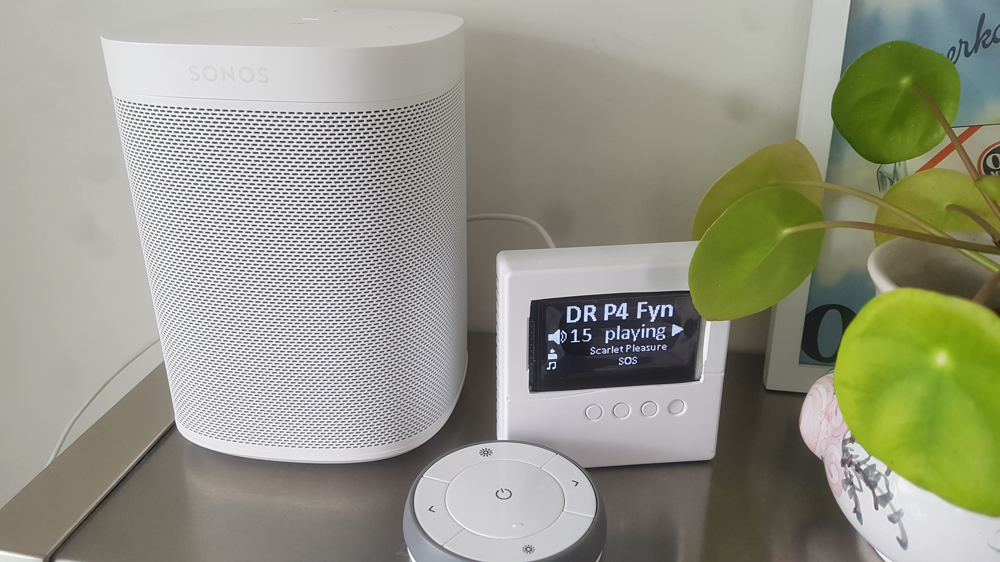

### SONOS/SYMFONISK single speaker

ControllerX can control single speakers 'out of the box' with the following small app setup.
Supports:

- Toggle play/pause, volume up/down, previous/next song (in playlist) and previous/next favourites from Sonos app (source list).

This favourites list can consist of both radio stations, playlists, podcasts etc. The source list is 'circular', meaning that choosing next when at the last source in the list will skip to the first one, and vice versa.

```yaml
office_sonos_controller:
  module: controllerx
  class: E1810MediaPlayerController
  controller: controller
  integration:
    name: z2m
    listen_to: mqtt
  volume_steps: 20 # default setting is 10. This will increase default steps to 20 from no volume to full volume
  media_player: media_player.office
```

### SONOS/SYMFONISK groups

ControllerX supports Sonos groups as well. If `media_player` in the app is set to a group, ControllerX will read the Sonos source list from the FIRST `entity_id` in the group. So this has to be your chosen main speaker! This setup will work perfectly, if you only use static groups that are never altered (via Sonos app/HA or otherwise). But if your Sonos group changes through the day (other family members redefine the group speakers to their liking), you need a dynamic group setting.

This can easily be achieved by adding only one sensor and one small automation to your HA configuration.

#### HA configuration.yaml

```yaml
- platform: template
  sensors:
    sonos_main_group_entities:
      value_template: "{{ state_attr('media_player.office', 'sonos_group') }}" #main speaker
```

#### HA automation.yaml

```yaml
id: dynamic_sonos_groups
alias: dynamic_sonos_groups
trigger:
  platform: state
  entity_id: sensor.sonos_main_group_entities # Same as defined in configuration.yaml
action:
  - service: group.set
    data_template:
      object_id: sonos_all #name of sonos group in groups.yaml
      entities: "{{ state_attr('media_player.office', 'sonos_group') | join(',') }}" #main speaker
```

#### HA groups.yaml

```yaml
name: sonos_all
entities:
  - media_player.office #this HAS to be your main speaker
  - media_player.kitchen #passive speaker #1
  - media_player.livingroom #passive speaker #2
```

And with the following ControllerX configuration, you will be able to control the dynamic group in HA, which will be updated immediately if the group is changed, e.g. from the Sonos app. The app below has 'flipped' the arrow functions, so click changes the source and hold changes to the previous/next song in the playlist. This behaviour will most likely fit better for users that primarily use favourites (radio stations).

#### AppDaemon apps.yaml

```yaml
sonos_group:
  module: controllerx
  class: MediaPlayerController
  controller: controller
  integration:
    name: z2m
    listen_to: mqtt
  volume_steps: 20
  media_player: group.sonos_all # Sonos group in groups.yaml
  mapping:
    toggle: play_pause
    brightness_up_click: click_volume_up
    brightness_down_click: click_volume_down
    brightness_up_hold: hold_volume_up
    brightness_down_hold: hold_volume_down
    brightness_up_release: release
    brightness_down_release: release
    arrow_right_click: next_source
    arrow_left_click: previous_source
    arrow_right_hold: next_track
    arrow_left_hold: previous_track
```

_This example was provided by [@htvekov](https://github.com/htvekov)_
