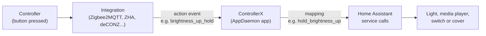

# ControllerX

_Create controller-based automations with ease to control your home devices and scenes from [Home Assistant](https://www.home-assistant.io/) (HA)._

_ControllerX_ brings the following functionalities to [many controllers](controllers/index.md):

- Turn on/off any home device (light, switch, media player, etc.)
- Manual increase/decrease of brightness and color temperature
- Smooth increase/decrease (holding a button) of brightness, color temperature, volume, etc.
- Color loop if the light supports xy color
- Play/pause music
- Open/close covers

[Get started](start/installation.md){ .md-button .md-button--primary } [Find your controller](controllers/index.md){ .md-button } [Build your configuration](start/config-builder.md){ .md-button }

## Why _ControllerX_?

Solutions like Zigbee2MQTT, deCONZ and ZHA have their pros and cons, but one of their benefits is that they remove the dependency on a proprietary hub (e.g. IKEA, Xiaomi, Philips). However, the proprietary hubs not only connect a controller with lights or media players, they also give them behaviour: dimming while a button is held, cycling colors, changing the volume, etc. Without the hub, we end up writing Home Assistant automations, and automations like these quickly get tricky and difficult to maintain.

This is where _ControllerX_ comes in, together with AppDaemon. It brings back the behaviour that the devices lose without the original hub, and makes it easy to create automations focused on button events.

## How it works



1. When a button is pressed, the [integration](start/integrations/index.md) fires an action event (e.g. `brightness_up_hold`).
2. ControllerX translates that event into a [predefined action](advanced/predefined-actions.md) (e.g. `hold_brightness_up`) using the default mapping of the device, or your own [custom mapping](advanced/index.md).
3. ControllerX calls the Home Assistant services to change the entity. When a button is held, it keeps calling them periodically until the release event arrives, so the brightness, color or volume changes smoothly.

## Quick example

With just this configuration placed in your [`apps.yaml`](start/configuration.md), you can have the E2002 controller from IKEA (4 buttons) connected to the living room light, and be able to change the brightness and the color temperature or color.

```yaml
livingroom_controller:
  module: controllerx
  class: E2002LightController
  controller: livingroom_controller
  integration:
    name: z2m
    listen_to: mqtt
  light: light.livingroom
```

!!! tip "Using an AI assistant?"

    This documentation is available in a format that AI assistants can read: [llms.txt](https://xaviml.github.io/controllerx/llms.txt) (index) and [llms-full.txt](https://xaviml.github.io/controllerx/llms-full.txt) (all the pages in one file). The list of supported devices is available as [JSON](controllers/devices.json).

## Video examples

- [E1810 (IKEA) controlling a light through MQTT](https://twitter.com/xaviml93/status/1292235973510733826)
- [Symfonisk controlling Chromecast volume](https://twitter.com/xaviml93/status/1278000379444240390)
- [Magic Xiaomi Cube controlling a colour light](https://twitter.com/xaviml93/status/1231542785486049280)
- [E1810 (IKEA) controlling a colour light with ZHA](https://twitter.com/xaviml93/status/1227573383489085440)
- [Symfonisk controlling Google Home mini](https://twitter.com/xaviml93/status/1216124464901115905)
- [Symfonisk controlling a light](https://twitter.com/xaviml93/status/1216297058581258240)
- [Showing the colour wheel from HA](https://twitter.com/xaviml93/status/1213978663294787595)
- [E1743 (IKEA) button as a cover controller](https://twitter.com/xaviml93/status/1279875564736741376)
- [E1810 (IKEA) as a TV remote](https://twitter.com/xaviml93/status/1279874124026970115)
- [Double click for the middle button for E1810 (IKEA)](https://twitter.com/xaviml93/status/1313238350913040384)

## Community

Thank you to all these people for sharing content related to ControllerX:

- [/u/canaletto](https://community.home-assistant.io/u/canaletto/summary) - [canaletto.fr](https://canaletto.fr/post/home-assistant-rc-and-lights) (French)
- [/u/jones](https://community.home-assistant.io/u/jones/summary) - [jbetzen.net](https://jbetzen.net/posts/controllerx/) (German)
- [/u/fribse](https://community.home-assistant.io/u/fribse/summary) - [YouTube](https://youtu.be/ZVsibNcc_tw) (Danish)

Questions can be asked in the following channels:

- [GitHub issue](https://github.com/xaviml/controllerx/issues/new?assignees=xaviml&labels=question&template=question.md&title=%5BQUESTION%5D)
- [Home Assistant Community Forum topic](https://community.home-assistant.io/t/controllerx-bring-full-functionality-to-light-and-media-player-controllers/148855)
